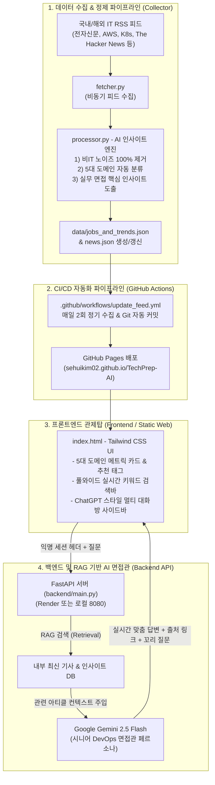

# 🚀 TechPrep-AI: 개발자 실시간 IT 트렌드 & 핵심 인사이트 관제탑

[](https://github.com/sehuikim02/TechPrep-AI/actions/workflows/update_feed.yml)
[](https://sehuikim02.github.io/TechPrep-AI/)

> **5대 핵심 도메인별 실시간 IT 트렌드 수집 및 RAG 기반 AI 실무 인사이트 & 시니어 면접 코칭 플랫폼**

---

## 🌐 라이브 웹 데모 (Live Demo)
👉 **[TechPrep-AI 바로가기 (GitHub Pages)](https://sehuikim02.github.io/TechPrep-AI/)**

---

## 💡 핵심 최신 기능 (Key Highlights)

1. **RAG (검색증강생성) 기반 최신 테크 이슈 자동 인용**:
   - 시스템이 수집·가공한 최신 IT 기사 및 실무 핵심 인사이트 데이터베이스(`news.json`)를 실시간 유사도 검색(Retrieval)
   - 질문과 가장 연관성 높은 실제 최신 이슈를 컨텍스트로 결합하여 Gemini API의 할루시네이션을 방지하고 신뢰도 높은 면접 답변을 생성
   - 챗봇 답변 하단에 **실제 참조한 기사 링크 및 핵심 인사이트 배지(`📌 출처`)**를 자동 표기

2. **익명 세션(UUID) 기반 멀티 채팅방 & 대화 내역 영구 보존**:
   - 회원가입이나 로그인 없이도 브라우저 고유 UUID를 발급하여 독립된 세션 관리
   - **ChatGPT 스타일의 사이드바 서랍(Drawer)** 제공: `+ New Chat` 버튼으로 새로운 주제의 대화방 개설 및 과거 대화 내역 전환/삭제
   - 새로고침하거나 브라우저 창을 닫아도 `localStorage`와 백엔드 세션 스토어를 통해 이전 대화 내용이 100% 보존

3. **5대 핵심 도메인 필터링 & 노이즈 100% 제거**:
   - `클라우드 아키텍처`, `인프라/DevOps`, `보안/침해사고`, `AI/머신러닝`, `IT 트렌드`로 자동 정밀 분류
   - 학습지, 아동 교육, 단순 소비재 등 비(非)IT 기사를 100% 사전 차단하는 지능형 필터 엔진 내장

4. **하이브리드 시연 아키텍처 (Hybrid Fallback Engine)**:
   - **Render 백엔드 환경**: FastAPI + Google Gemini 2.5 Flash API + 서버 사이드 세션 스토어
   - **GitHub Pages 정적 호스팅 환경**: 백엔드 연결 유무와 무관하게 브라우저 단독으로 작동하는 클라이언트 사이드 RAG 및 시니어 면접관 지능형 응답 엔진 내장

---

## 🏗️ 시스템 아키텍처 (System Architecture)



---

## 📁 프로젝트 디렉터리 구조 (Directory Structure)

```text
TechPrep-AI/
├── .github/
│   └── workflows/
│       └── update_feed.yml       # [자동화] 매일 2회 RSS 수집 실행 & GitHub Pages 자동 배포
├── backend/
│   ├── main.py                  # [백엔드] FastAPI 서버: RAG 검색, 세션별 채팅방 관리, Gemini API 챗봇
│   └── run_server.py            # [실행] Uvicorn 기반 로컬 개발용 서버 실행 스크립트
├── collector/
│   ├── config.py                # [설정] 9대 RSS 피드 목록 및 5대 도메인 키워드/제외어 정의
│   ├── fetcher.py               # [수집기] RSS/XML 파싱 및 실시간 뉴스 항목 추출
│   ├── processor.py             # [인사이트 엔진] 비IT 기사 필터링, 5대 카테고리 분류, 실무 핵심 인사이트 생성
│   ├── sample_data.py           # [시드 데이터] 오프라인/네트워크 오류 시 사용할 고품질 면접 기출 데이터
│   └── main.py                  # [수집 실행] 수집-가공-JSON 저장을 총괄하는 파이프라인 진입점
├── data/
│   ├── jobs_and_trends.json     # [데이터] 가공 완료된 전체 기사 및 메타데이터 아카이브
│   └── news.json                # [데이터] 프론트엔드 연동용 JSON
├── frontend/
│   ├── index.html               # [웹 UI 원본] Tailwind CSS 기반 반응형 대시보드
│   └── jobs_and_trends.json     # [프론트엔드용 복사본]
├── index.html                   # [배포용] GitHub Pages 루트 호스팅용 웹 파일
├── jobs_and_trends.json         # [배포용] GitHub Pages 루트 데이터셋
├── news.json                    # [배포용] GitHub Pages 루트 데이터셋
├── requirements.txt             # [의존성] Render 배포 및 로컬 실행에 필요한 필수 패키지 목록
└── .gitignore                   # [보안] .env 등 개인 API 키 및 캐시 파일의 Git 업로드 방지
```

---

## ⚙️ 주요 API 명세 (Backend Endpoints)

| Method | Endpoint | 설명 |
|---|---|---|
| `POST` | `/api/chat` | RAG 기반 최신 기사 검색 및 Gemini 시니어 면접관 답변 생성 |
| `GET` | `/api/chats` | 클라이언트 세션(`X-Session-ID`)에 속한 전체 채팅방 목록 조회 |
| `POST` | `/api/chats` | 새로운 채팅방(`+ New Chat`) 생성 |
| `GET` | `/api/chats/{room_id}/messages` | 특정 채팅방의 과거 대화 내역 조회 |
| `DELETE` | `/api/chats/{room_id}` | 특정 채팅방 삭제 |
| `GET` | `/api/status` | 타겟 인프라 상태 및 가상 시뮬레이션 지표 확인 |

---

## 🛠️ 기술 스택 (Tech Stack)

| 영역 | 기술 / 라이브러리 |
|---|---|
| **Frontend** | HTML5, Tailwind CSS, FontAwesome, Pretendard (공식 jsdelivr CDN) |
| **Backend API** | Python 3.12, FastAPI, Uvicorn, Pydantic |
| **AI / RAG** | Google Gemini 2.5 Flash (`google-genai` v1beta), Custom Keyword RAG Engine |
| **Automation** | GitHub Actions (`update_feed.yml`), Cron Schedule |
| **Deployment** | GitHub Pages (프론트엔드 웹), Render (백엔드 웹 서비스) |

---

## 💻 로컬 실행 가이드 (Local Development)

```bash
# 1. 저장소 클론
git clone https://github.com/sehuikim02/TechPrep-AI.git
cd TechPrep-AI

# 2. 필수 의존성 설치
pip install -r requirements.txt

# 3. 환경 변수 설정 (.env 파일 생성)
echo 'GEMINI_API_KEY="your_api_key_here"' > .env

# 4. 데이터 파이프라인 수동 실행
python3 -m collector.main

# 5. 백엔드 & 통합 웹 서버 실행 (포트 8080)
uvicorn backend.main:app --host 0.0.0.0 --port 8080
```
브라우저에서 `http://localhost:8080`에 접속하시면 관제탑과 RAG 멀티 채팅 멘토를 바로 확인하실 수 있습니다.
