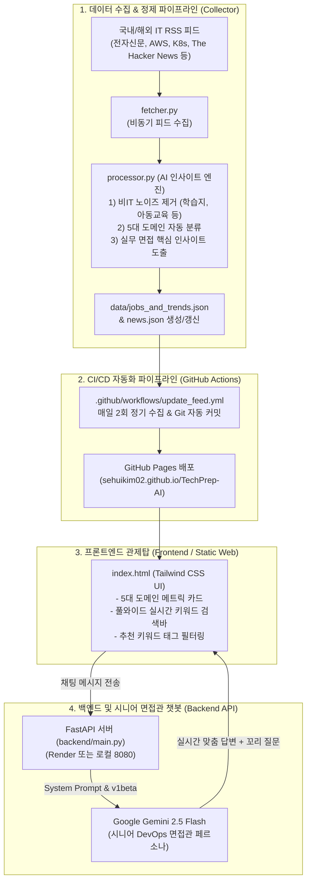

# 🚀 TechPrep-AI: 개발자 실시간 IT 트렌드 & 핵심 인사이트 관제탑

[](https://github.com/sehuikim02/TechPrep-AI/actions/workflows/update_feed.yml)
[](https://sehuikim02.github.io/TechPrep-AI/)

> **5대 핵심 도메인별 실시간 IT 트렌드 수집 및 AI 기반 실무 인사이트 & 시니어 면접 코칭 플랫폼**

---

## 🌐 라이브 웹 데모 (Live Demo)
👉 **[TechPrep-AI 바로가기 (GitHub Pages)](https://sehuikim02.github.io/TechPrep-AI/)**

---

## 🏗️ 시스템 아키텍처 (System Architecture)



---

## 📁 프로젝트 디렉터리 구조 (Directory Structure)

```text
TechPrep-AI/
├── .github/
│   └── workflows/
│       └── update_feed.yml       # [자동화] 매일 2회 RSS 수집 실행 & GitHub Pages 자동 배포
├── backend/
│   ├── main.py                  # [백엔드] FastAPI 서버: Gemini API 연동 챗봇(/api/chat), 정적 파일 서빙
│   └── run_server.py            # [실행] Uvicorn 기반 로컬 개발용 서버 실행 스크립트
├── collector/
│   ├── config.py                # [설정] 9대 RSS 피드 목록 및 5대 도메인 키워드/제외어 정의
│   ├── fetcher.py               # [수집기] RSS/XML 파싱 및 실시간 뉴스 항목 추출
│   ├── processor.py             # [인사이트 엔진] 비IT 기사 필터링, 5대 카테고리 분류, 실무 핵심 인사이트 생성
│   ├── sample_data.py           # [시드 데이터] 오프라인/네트워크 오류 시 사용할 고품질 면접 기출 데이터
│   └── main.py                  # [수집 실행] 수집-가공-JSON 저장을 총괄하는 파이프라인 진입점
├── data/
│   ├── jobs_and_trends.json     # [데이터] 가공 완료된 전체 기사 및 메타데이터 아카이브
│   └── news.json                # [데이터] 프론트엔드 연동용 JSON
├── frontend/
│   ├── index.html               # [웹 UI 원본] Tailwind CSS 기반 반응형 대시보드
│   └── jobs_and_trends.json     # [프론트엔드용 복사본]
├── index.html                   # [배포용] GitHub Pages 루트 호스팅용 웹 파일
├── jobs_and_trends.json         # [배포용] GitHub Pages 루트 데이터셋
├── news.json                    # [배포용] GitHub Pages 루트 데이터셋
├── requirements.txt             # [의존성] Render 배포 및 로컬 실행에 필요한 필수 패키지 목록
└── .gitignore                   # [보안] .env 등 개인 API 키 및 캐시 파일의 Git 업로드 방지
```

---

## ⚙️ 단계별 작동 원리 (Workflow)

### 1. 데이터 수집 & 정제 (`collector/`)
- `fetcher.py`가 국내외 9개 주요 테크 피드(전자신문, AWS Blog, Kubernetes Blog, The Hacker News 등)에서 기사를 수집합니다.
- `processor.py`가 비(非)IT 기사(학습지, 아동 교육, 단순 소비재 등)를 100% 필터링하고, 5대 도메인으로 분류한 뒤 각 기사마다 **실제 면접관이 주목할 아키텍처 관점의 실무 핵심 인사이트**를 자동 도출합니다.

### 2. CI/CD 완전자동화 파이프라인 (GitHub Actions)
- 매일 2회 정기적으로 GitHub Actions 클라우드 인프라에서 수집 스크립트가 실행되어, 최신 데이터를 커밋하고 **GitHub Pages에 무중단 자동 배포**합니다.

### 3. 직관적인 브라이트 관제탑 UI (`frontend/`)
- 파스텔톤 브라이트 테마와 반응형 카드 그리드를 적용하여 가독성을 극대화했습니다.
- 상단 카테고리 카드 클릭, 풀와이드 실시간 검색바, 추천 기술 태그(`#Kubernetes`, `#Docker`, `#AWS` 등)를 통해 원하는 기술 이슈를 1초 만에 모아볼 수 있습니다.

### 4. 하이브리드 AI 면접 멘토 챗봇 (Gemini 2.5 Flash)
- **10년 차 IT 대기업 시니어 DevOps / 백엔드 면접관 페르소나**를 탑재하여, 주니어 지원자의 눈높이에 맞춘 모범 답변 구조(STAR 기법)와 꼬리 질문 코칭을 제공합니다.
- 백엔드(Render/로컬) 환경에서는 안전하게 격리된 **Gemini API**로 동작하며, 정적 GitHub Pages 단독 배포 환경에서도 끊김 없는 시연이 가능한 **클라이언트 사이드 지능형 엔진**이 결합된 하이브리드 구조입니다.

---

## 🛠️ 기술 스택 (Tech Stack)

| 영역 | 기술 / 라이브러리 |
|---|---|
| **Frontend** | HTML5, Tailwind CSS, FontAwesome, Vanilla JS |
| **Backend API** | Python 3.12, FastAPI, Uvicorn, Pydantic |
| **AI Model** | Google Gemini 2.5 Flash (`google-genai` SDK v1beta) |
| **Automation** | GitHub Actions (`update_feed.yml`), Cron Schedule |
| **Deployment** | GitHub Pages (프론트엔드), Render (백엔드) |

---

## 💻 로컬 실행 가이드 (Local Development)

```bash
# 1. 저장소 클론
git clone https://github.com/sehuikim02/TechPrep-AI.git
cd TechPrep-AI

# 2. 필수 의존성 설치
pip install -r requirements.txt

# 3. 환경 변수 설정 (.env 파일 생성)
echo 'GEMINI_API_KEY="your_api_key_here"' > .env

# 4. 데이터 파이프라인 수동 실행
python3 -m collector.main

# 5. 백엔드 & 통합 웹 서버 실행 (포트 8080)
uvicorn backend.main:app --host 0.0.0.0 --port 8080
```
브라우저에서 `http://localhost:8080`에 접속하시면 관제탑과 AI 멘토 챗봇을 바로 확인하실 수 있습니다.
